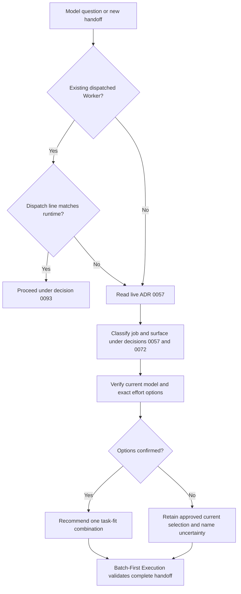

# Session Model Advisor -- workflow diagram

The current picker or supported API establishes account-specific options;
provider docs clarify their meaning. The companion Claude Code SessionStart
hook reports configuration only. It does not select a model or replace the
advisor. A matching dispatch does not repeat the full classification.
