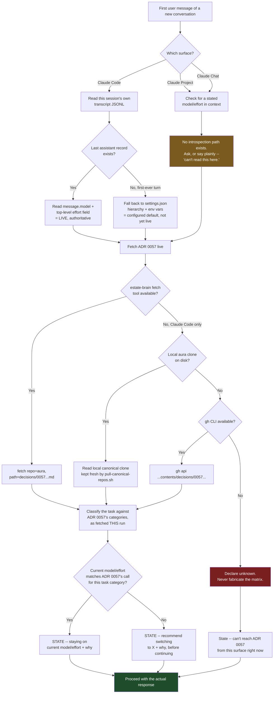

# Session Model Advisor -- workflow diagram

Technical/internal track (Mermaid), per the four-artifact rule's own split -- Excalidraw for customer-facing skills, Mermaid for technical/internal ones. This skill has no customer-facing audience, so Mermaid is the correct choice, not a substitute for one.

## Reading the diagram

- The two amber/red boxes are the honesty points -- "can't see this on Chat/Projects" and "can't fabricate the matrix if every fetch path fails." Both are intended dead ends that still produce a truthful Step 5 line, not a crash and not a guess.
- Every path converges on the same Step 5 statement before the real response starts (green box). That convergence is the whole point of the skill -- no branch skips the fit-check, it only changes what the fit-check is allowed to claim.
- The companion SessionStart hook (see `session-model-effort-banner.sh`) is not on this diagram. It runs earlier, at session start, and only prints a banner -- it feeds nothing into this flow except, optionally, a shortcut so Step 2 on Claude Code can read the hook's already-printed line instead of re-deriving it.
